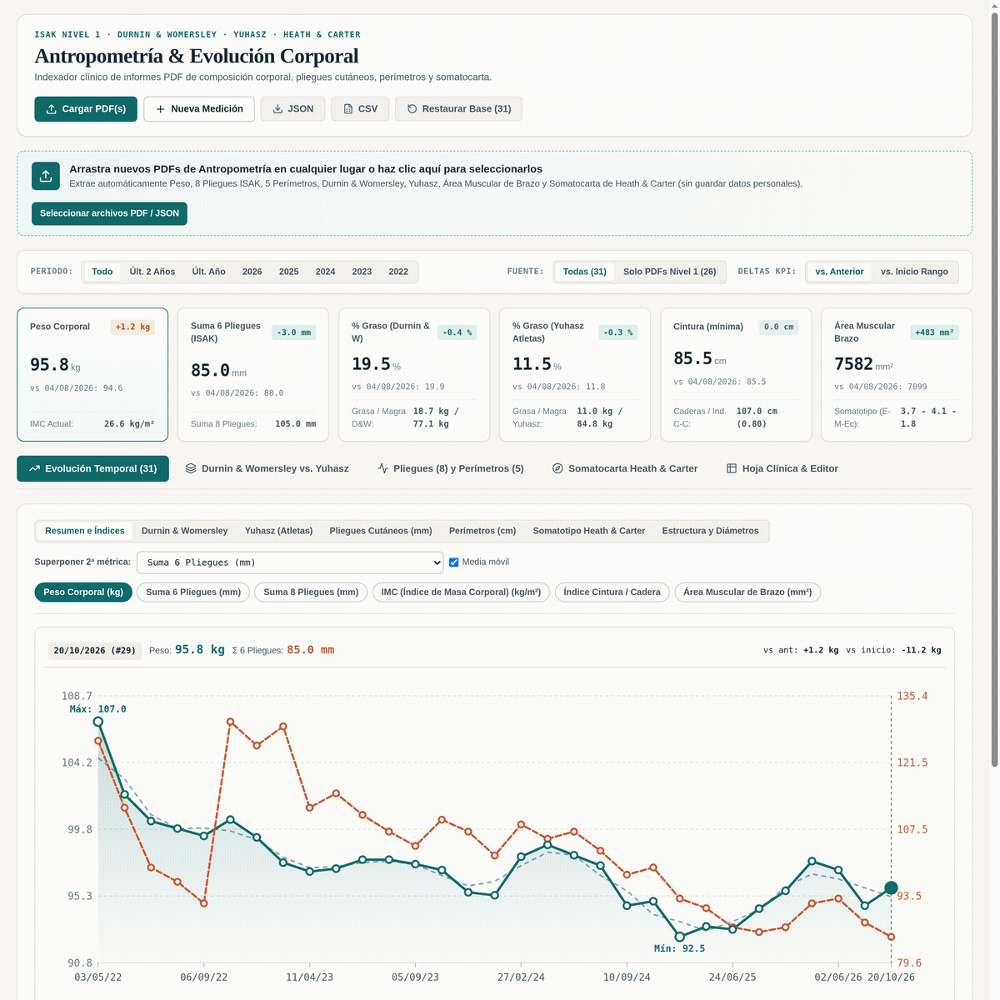
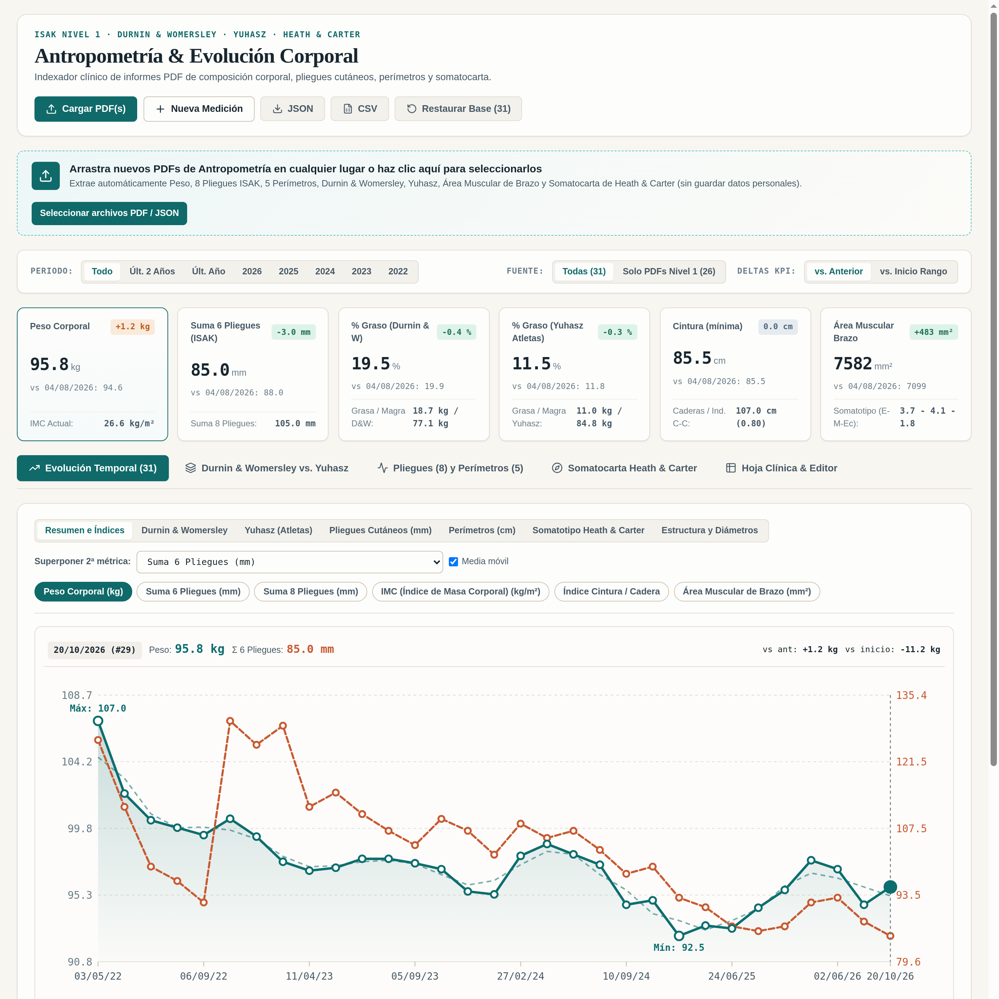
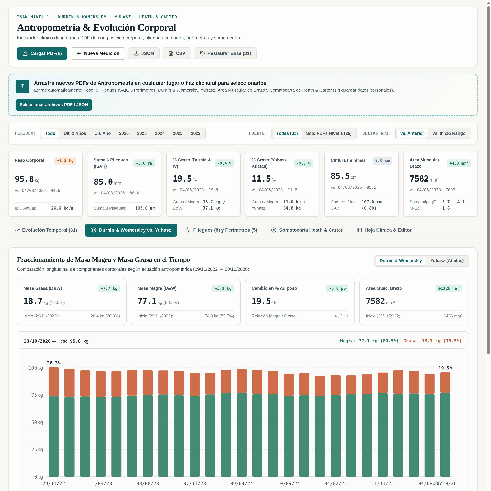
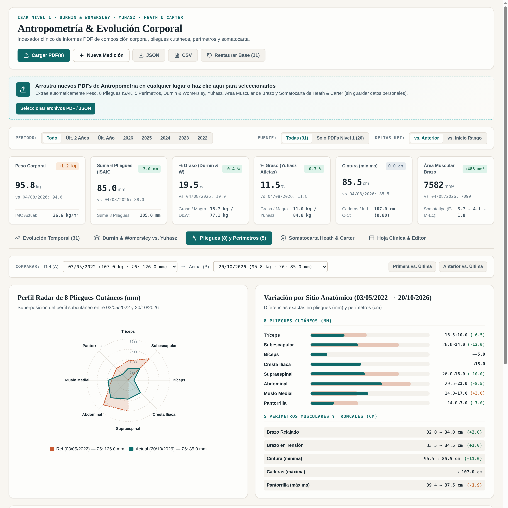
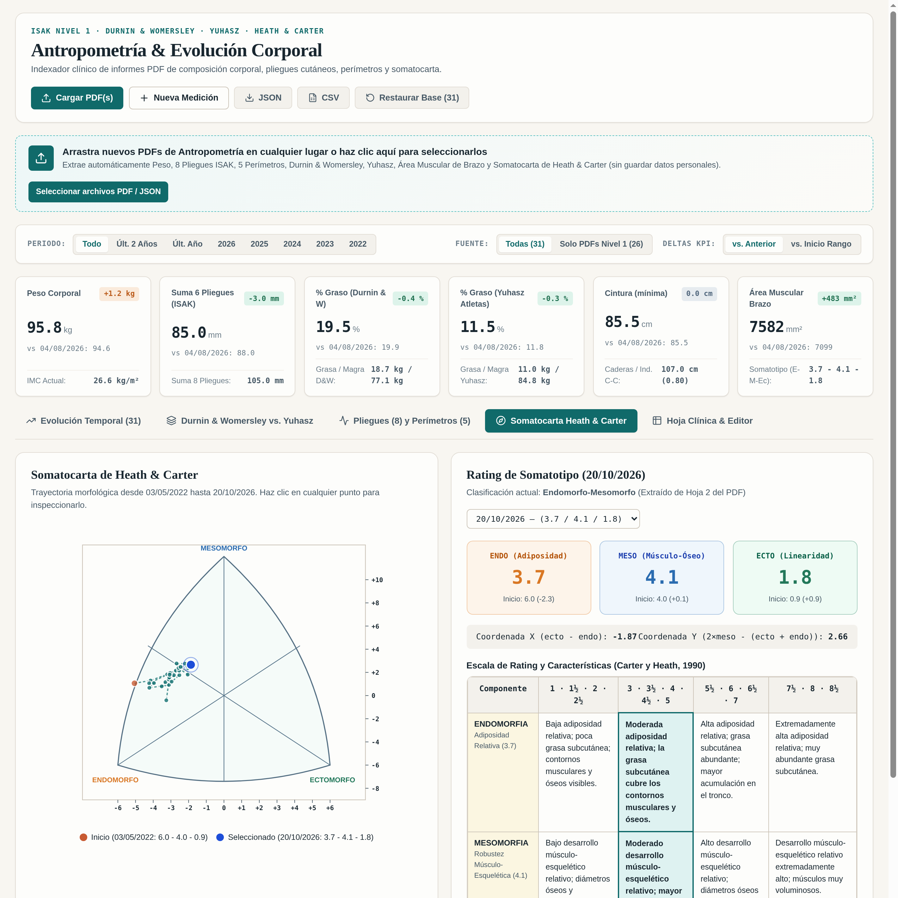
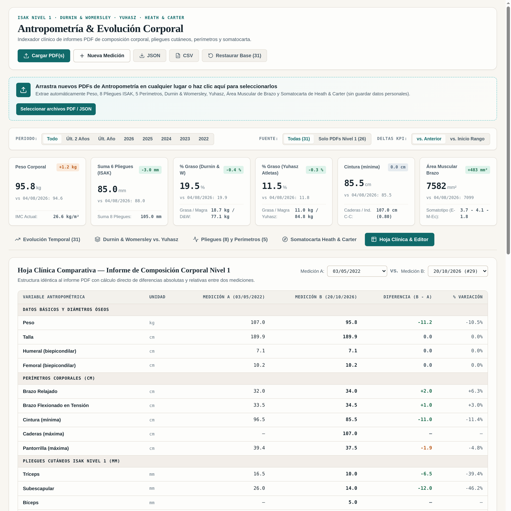
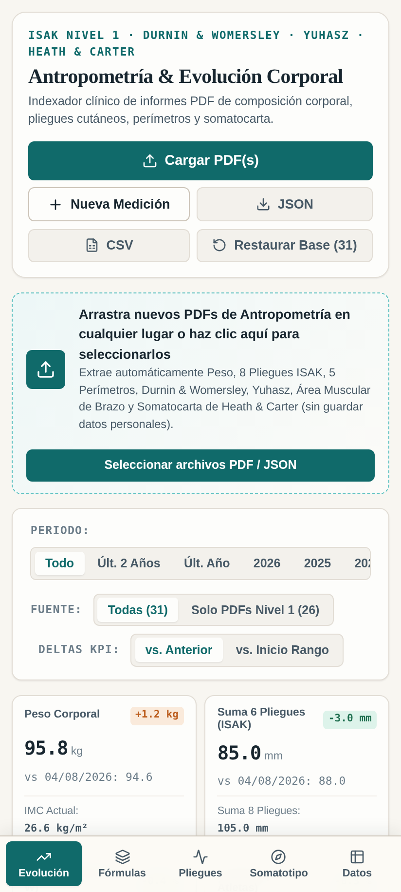
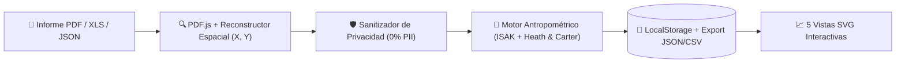

<div align="center">

# 📊 Antropometría & Evolución Corporal
### Indexador Clínico de Informes PDF (ISAK Nivel 1 · Durnin & Womersley · Yuhasz · Somatocarta de Heath & Carter)

[](https://akurc.com/indexer-body-mass/)
[](#variables-y-métricas-indexadas)
[-23785a?style=for-the-badge)](#privacidad-y-arquitectura-100-client-side)
[](#experiencia-móvil-y-táctil)

<p align="center">
  Aplicación web estática diseñada para alojarse en <strong>GitHub Pages</strong> que procesa hojas de resultados de antropometría en formato <strong>PDF</strong> (1 o 2 páginas), planillas <strong>Excel (<code>.xls</code>/<code>.xlsx</code>)</strong> y respaldos <strong>JSON</strong> directamente en el navegador, generando paneles interactivos de evolución longitudinal, fraccionamiento corporal, perfiles radar de pliegues y la <strong>Somatocarta de Heath & Carter</strong>.
</p>

<p align="center">
  👉 <strong><a href="https://akurc.com/indexer-body-mass/">Abrir Aplicación en Vivo (akurc.com/indexer-body-mass)</a></strong> 👈
</p>

---

### ✨ Recorrido Visual Interactivo



</div>

---

## 🎯 ¿Qué resuelve esta aplicación?

Los informes antropométricos entregados en consulta nutricional suelen quedar aislados en archivos PDF individuales por fecha (`Antropometría 23-01-05.pdf`, `Antropometría 26-10-20.pdf`, etc.), dificultando analizar tendencias de largo plazo o comparar cómo impactó un bloque de entrenamiento y nutrición en cada pliegue cutáneo y perímetro muscular.

Esta aplicación convierte esos PDFs estáticos en una **plataforma analítica longitudinal** sin necesidad de servidores ni bases de datos externas:

1. **Arrastras uno o múltiples PDFs** en cualquier parte de la pantalla.
2. El motor [`pdfParser.js`](./src/utils/pdfParser.js) reconstruye las filas visuales del PDF ordenando las coordenadas espaciales `(X, Y)` de cada fragmento de texto mediante `pdf.js`.
3. **Filtra y descarta automáticamente cualquier dato personal** (nombre del paciente, edad, nombre del profesional y matrícula), conservando únicamente la fecha, el número de medición y las variables biométricas.
4. **Completa y verifica cálculos antropométricos** ([`anthropometryMath.js`](./src/utils/anthropometryMath.js)): incluso cuando se carga un PDF antiguo de 1 sola página (sin hoja de Somatocarta), el sistema calcula automáticamente la **Endomorfia, Mesomorfia, Ectomorfia y coordenadas `(X, Y)`** con las ecuaciones oficiales de *Carter & Heath (1990)*.

---

## 🖼️ Galería de Vistas Analíticas

### 1. Evolución Temporal en Doble Eje y Panel de Mini-Gráficos (*Small Multiples*)
Permite graficar cualquiera de las **30+ variables** en el eje principal y **superponer una 2ª métrica en el eje derecho** (por ejemplo, *Peso Corporal* en `kg` contra *Suma de 6 Pliegues* en `mm`), con línea de **media móvil de 3 mediciones**, marcadores automáticos de **mínimo y máximo histórico**, e indicadores KPI con deltas instantáneos (`vs. medición anterior` o `vs. inicio del periodo`).



---

### 2. Fraccionamiento Corporal: Durnin & Womersley vs. Yuhasz (Atletas)
Compara longitudinalmente la evolución de la **Masa Magra (`kg` y `%`)** y la **Masa Grasa (`kg` y `%`)** bajo ambos modelos incluidos en la planilla clínica:
- **Durnin & Womersley** (población general, resaltado en amarillo en el informe original).
- **Yuhasz (6 pliegues para atletas)** (resaltado en terracota en el informe original), junto con el seguimiento del **Área Muscular de Brazo (`mm²`)**.



---

### 3. Mapa Anatómico: Radar de 8 Pliegues Cutáneos y 5 Perímetros
Superpone dos fechas cualesquiera en un **Gráfico Radar/Araña de 8 ejes** para observar en qué zonas anatómicas se redujo el tejido adiposo subcutáneo (*Tríceps, Subescapular, Bíceps, Cresta Ilíaca, Supraespinal, Abdominal, Muslo Medial, Pantorrilla*) y cómo evolucionaron los **5 perímetros musculares y troncales**, acompañado de curvas simultáneas filtrables por sitio anatómico.



---

### 4. Somatocarta de Heath & Carter y Escala de Rating (1990)
Recrea en SVG vectorial la **Somatocarta de Heath & Carter** (triángulo curvo de Reuleaux con vértices en `MESOMORFO`, `ENDOMORFO` y `ECTOMORFO`) y traza la **trayectoria morfológica histórica** punto por punto desde la primera medición hasta la actual. Al seleccionar cualquier fecha, resalta automáticamente los casilleros correspondientes en la **Escala de Rating y Características (Carter y Heath, 1990)**.



---

### 5. Hoja Clínica Comparativa (Nivel 1) y Editor Manual
Reproduce la estructura exacta del **Informe de Composición Corporal Nivel 1** enfrentando lado a lado cualquier **Medición A** contra **Medición B**, calculando la diferencia absoluta (`B - A`) y porcentual (`% Variación`) fila por fila. Incluye además la matriz histórica completa con edición manual, creación de registros sin PDF y exportación/importación en **JSON** y **CSV**.



---

## 📱 Experiencia Móvil y Táctil (*Mobile-First Ready*)

<table>
  <tr>
    <td width="38%" align="center">
      
    </td>
    <td width="62%" valign="top">
      <h3>Diseñada para consultarla desde el teléfono</h3>
      <ul>
        <li><strong>Barra de navegación inferior fija (<em>Bottom Tab Bar</em>)</strong>: En pantallas móviles (<code>&le; 860px</code>), las 5 vistas principales pasan a una barra inferior estilo app nativa con soporte para <code>safe-area-inset-bottom</code>.</li>
        <li><strong><em>Touch Scrubbing</em> en gráficos</strong>: Desliza el dedo horizontalmente sobre las curvas de progreso o las barras apiladas para inspeccionar fecha por fecha sin necesidad de cursor.</li>
        <li><strong>Grilla compacta de 2 columnas</strong>: Las 6 tarjetas KPI y los mini-gráficos se organizan de a pares para mostrar todo el resumen ejecutivo de un vistazo.</li>
        <li><strong>Carga directa desde el celular</strong>: El botón <em>Cargar PDF(s)</em> abre el selector nativo de archivos de iOS/Android (Archivos, Google Drive, WhatsApp o iCloud).</li>
      </ul>
    </td>
  </tr>
</table>

---

## 🔒 Privacidad y Arquitectura 100% Client-Side

Todo el procesamiento ocurre localmente en el navegador del usuario: **ningún PDF ni dato corporal se envía a servidores externos**.



---

## 📏 Variables y Métricas Indexadas (30+ campos)

| Categoría | Variables Extraídas / Calculadas | Unidad |
| :--- | :--- | :---: |
| **1. Básicos y Diámetros Óseos** | Peso Corporal, Talla, Diámetro Humeral (biepicondilar), Diámetro Femoral (biepicondilar) | `kg`, `cm` |
| **2. Perímetros Corporales (5)** | Brazo Relajado, Brazo Flexionado en Tensión, Cintura (mínima), Caderas (máxima), Pantorrilla (máxima) | `cm` |
| **3. Pliegues Cutáneos ISAK (8)** | Tríceps, Subescapular, Bíceps, Cresta Ilíaca, Supraespinal, Abdominal, Muslo (medial), Pantorrilla | `mm` |
| **4. Índices Antropométricos** | Índice de Masa Corporal (IMC), Índice Cintura/Cadera, Suma de 6 Pliegues, Suma de 8 Pliegues, Área Muscular de Brazo | `kg/m²`, `mm`, `mm²` |
| **5. Durnin & Womersley** | Porcentaje Graso (`% graso Durnin & W`), Masa Grasa (`kg`), Masa Magra (`kg`) | `%`, `kg` |
| **6. Yuhasz (Atletas)** | Porcentaje Graso (`% graso Yuhasz`), Masa Grasa (`kg`), Masa Magra (`kg`) | `%`, `kg` |
| **7. Somatotipo Heath & Carter** | Endomorfia (`ENDO`), Mesomorfia (`MESO`), Ectomorfia (`ECTO`), Coordenada `X`, Coordenada `Y` y Clasificación Morfológica | `rating`, `(X, Y)` |

### Fórmulas Antropométricas Integradas

Cuando se cargan informes de 1 página o planillas en bruto, [`anthropometryMath.js`](./src/utils/anthropometryMath.js) calcula automáticamente los indicadores derivados con las mismas ecuaciones de la hoja clínica:

- **Suma de 6 Pliegues ($\Sigma 6$, mm)**:
  $$\Sigma 6 = \text{Tríceps} + \text{Subescapular} + \text{Supraespinal} + \text{Abdominal} + \text{Muslo Medial} + \text{Pantorrilla}$$
- **Suma de 8 Pliegues ISAK ($\Sigma 8$, mm)**:
  $$\Sigma 8 = \Sigma 6 + \text{Bíceps} + \text{Cresta Ilíaca}$$
- **Porcentaje Graso Yuhasz (Atletas)**:
  $$\%\text{Graso}_{\text{Yuhasz}} = 0.1051 \times \Sigma 6 + 2.585$$
- **Área Muscular de Brazo ($\text{AMB}$, $\text{mm}^2$)**:
  $$\text{AMB} = \frac{(\text{Perímetro Brazo Relajado}_{\text{mm}} - \pi \times \text{Pliegue Tríceps}_{\text{mm}})^2}{4\pi}$$
- **Somatotipo de Heath & Carter (Carter & Heath, 1990)**:
  - **Endomorfia**: $X_c = (\text{Tríceps} + \text{Subescapular} + \text{Supraespinal}) \times \frac{170.18}{\text{Talla}}$, $\quad \text{ENDO} = -0.7182 + 0.1451 X_c - 0.00068 X_c^2 + 0.0000014 X_c^3$
  - **Mesomorfia**: $\text{MESO} = 0.858 \cdot \text{Humeral} + 0.601 \cdot \text{Femoral} + 0.188 \cdot \left(\text{Brazo Tensión} - \frac{\text{Tríceps}}{10}\right) + 0.161 \cdot \left(\text{Pantorrilla Perím.} - \frac{\text{Pantorrilla Pliegue}}{10}\right) - 0.131 \cdot \text{Talla} + 4.5$
  - **Ectomorfia**: A partir del Índice Ponderal $\text{IP} = \frac{\text{Talla}}{\sqrt[3]{\text{Peso}}}$
  - **Coordenadas en Somatocarta**: $X = \text{ECTO} - \text{ENDO}$, $\quad Y = 2 \times \text{MESO} - (\text{ECTO} + \text{ENDO})$

---

## 🛠️ Instalación y Uso Local

```bash
# 1. Clonar el repositorio
git clone https://github.com/alankurc/indexer-body-mass.git
cd indexer-body-mass

# 2. Instalar dependencias
npm install

# 3. Iniciar servidor de desarrollo (http://localhost:5173)
npm run dev

# 4. Compilar versión estática de producción para GitHub Pages (carpeta dist/)
npm run build
```

## 🚀 Despliegue Automático en GitHub Pages

El repositorio incluye el workflow [`.github/workflows/deploy.yml`](./.github/workflows/deploy.yml), configurado para compilar el proyecto con Vite (`base: './'`) y desplegarlo automáticamente en **GitHub Pages** ante cada `push` a la rama `main`.
